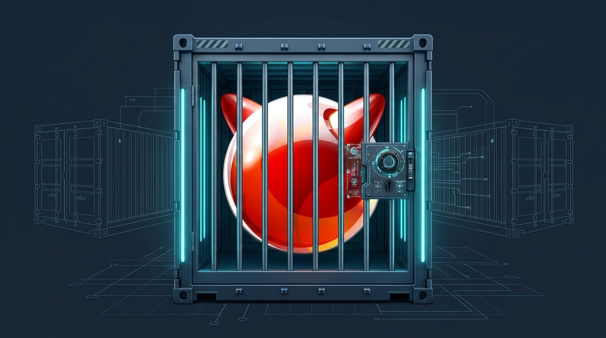

<p align="center">
  
</p>

# jailer

`jailer` is a standalone FreeBSD OCI image builder, local jail test runner, compatibility checker, and registry publisher designed for [Legion](https://github.com/grepjava/legion) — and usable on any FreeBSD host without it.

It covers the pre-deployment workflow before scheduling containers onto a Legion cluster:

```sh
jailer init                 # Scaffold a Containerfile
jailer build                # Build a FreeBSD OCI image
jailer run                  # Test locally in a jail
jailer push ghcr.io/me/app  # Publish for Legion
jailer export app.tar       # Produce an offline OCI archive
```

## Why `jailer`?

Legion pulls OCI images, stores their layers on ZFS, and runs containers as jails, intentionally leaving image building out of the cluster daemon. `jailer` fills the local development and CI workflow while matching Legion's exact runtime semantics:

- **Zero external container dependencies:** Includes a native `Containerfile` parser (multi-stage builds, `COPY --from` a stage or an image, `--chown`, `--chmod`, `RUN --mount` cache, bind, secret, ssh and tmpfs mounts, `RUN --network=none`, here-documents, `COPY --exclude/--parents`, `ADD <url> --checksum`, `ONBUILD`, `.containerignore`, jail parameters, SysV IPC and resource limits for `RUN` steps (`--param`, `--sysv`, `-m`, `--cpus`, `--pids-limit`, `--cpuset-cpus`), `--label`, `--annotation` and reproducible `--timestamp`, gzip or zstd layers, ZFS clones for stages, and a build cache kept locally or in a registry with `--cache-to`/`--cache-from`), OCI layer differ (with `.wh.` whiteouts, FreeBSD file flags and hard links), and OCI Distribution API client (`pull` and `push`, with cosign-compatible signing: `push --sign-key`, `sign`, `verify`). Can also delegate builds to `buildah` (`--backend buildah`). [What is supported](docs/COMPATIBILITY.md), tested against BuildKit and Buildah.
- **Local testing with Legion's runtime:** `jailer run` runs images with Legion's own `legion-jail`, as a node does, though without its agent ([what differs](docs/LOCAL-AND-LEGION.md)):
  - ZFS snapshot/clone layers (`<dataset>/<chain>@layer`) with an automatic plain-directory fallback when ZFS is unavailable.
  - `/etc/passwd` and `/etc/group` user & supplementary group resolution inside the jail.
  - `devfs` ruleset 4 mounted at `/dev`, Legion's security defaults (`enforce_statfs=2`, `securelevel=2`, no raw sockets or file flags; `--param` overrides them), and symlink-safe `nullfs` volume mounts (`-v`).
  - VNET pods on jailer's own bridge (`--vnet`), with NAT out and published ports (`-p 8080:80`) through pf anchors under `jailer/`, or loopback only (`--network none`).
  - Resource limits as rctl rules (`-m`, `--cpus`, `--pids-limit`) and CPU sets (`--cpuset-cpus`), `allow.mlock` (`--allow-mlock`), SysV IPC (`--sysv`), and FreeBSD Linux ABI support (`--linux` mounting `linprocfs`, `linsysfs`, `fdescfs`, and `/dev/shm`).
- **Build-time Legion compatibility checks (`jailer check`):** Catches image configuration issues at build time instead of deploy time:
  - Verifies `USER` against the image's `/etc/passwd` and `/etc/group`.
  - Verifies `ENTRYPOINT` / `CMD` exist and are executable inside the image rootfs along `PATH`.
  - Validates `STOPSIGNAL` and image platform (`freebsd/amd64`, `freebsd/arm64`).
  - Warns on `Containerfile` settings Legion ignores (`HEALTHCHECK`) and uncleaned `pkg` caches (`/var/cache/pkg`, `/var/db/pkg/repos`).
- **Offline archives for `legion image load`:** `jailer export app.tar` writes an `oci-archive` tarball annotated with `org.opencontainers.image.ref.name`, ready for `legion image load app.tar --zfs-root zroot/legion`.

## Compared with other tools

Other FreeBSD tools, as their own documentation described them in November 2026:

| Tool | What it is for | OCI images |
|---|---|---|
| [Podman](https://podman.io) and [Buildah](https://buildah.io) with [ocijail](https://github.com/dfr/ocijail) | Docker-compatible engine; its FreeBSD port is marked experimental | Builds, runs, pushes and pulls |
| [AppJail](https://github.com/DtxdF/AppJail) | Jail manager with Makejails; `appjail oci` runs OCI images as jails | Runs; builds through Buildah |
| [Bastille](https://github.com/BastilleBSD/bastille) | Jail manager with Bastillefile templates | None; exports its own archives |
| [pot](https://github.com/bsdpot/pot) | Jail manager with flavours, Potluck images and Nomad scheduling | None; its own image format |
| [iocage](https://github.com/freebsd/iocage) | Jail manager | None |

`jailer` overlaps most with Podman and Buildah. It differs in being one binary with no container stack to install, in running images with Legion's own jail code so a local run behaves as on a Legion node, and in `jailer check`. It is not a service manager: it has no restart policies or boot-time start, so for long-running jails on one host, Bastille, AppJail, pot or Podman fit better.

## Commands

| Command | Description |
|---|---|
| `jailer init [--template rust\|go\|node\|python\|c\|pkg\|runtime] [dir]` | Auto-detect project type and scaffold a `Containerfile` & `.containerignore` |
| `jailer build [-t name:tag] [-f Containerfile] [context]` | Build a FreeBSD OCI image and run Legion compatibility checks |
| `jailer run [-d] [-it] [-e K=V] [-v src:dst[:ro]] [-u user] [image] [cmd...]` | Run and test an image locally in a FreeBSD jail |
| `jailer push [source-image] <registry/repo:tag>` | Push an image to an OCI registry (Docker Hub, GHCR, Harbor, etc.) |
| `jailer export [image] <output.tar>` | Export an offline OCI archive for `legion image load` |
| `jailer check [image-or-dir]` | Validate a `Containerfile` and/or built image against Legion's runtime |
| `jailer manifest push <registry/repo:tag> <source>...` | Publish one name for several architectures (an OCI image index) |
| `jailer manifest inspect <reference>` | Show the manifest or index a registry holds |
| `jailer sign --key k.key <ref>` / `jailer verify --key k.pub <ref>` | Sign an image in a registry as cosign does, or check its signature |
| `jailer key generate [prefix]` | Make a P-256 key pair for signing |
| `jailer pull <reference>` | Pull an image from an OCI registry into the local store |
| `jailer load <archive.tar>` | Load an OCI archive into the local store |
| `jailer images` / `jailer rmi <ref>` | List or remove local images |
| `jailer prune [--cache]` | Free layers nothing uses; `--cache` also clears the build cache |
| `jailer ps` / `jailer logs` / `jailer exec` / `jailer stop` / `jailer rm` | Manage detached test containers |

## Installing

Release tarballs for FreeBSD 15.1 and later, amd64 and aarch64, are on
the [releases page](https://github.com/grepjava/jailer/releases). They
are built on 15.1 and need its libc, so on 15.0 build from source or the
port.

```sh
t=jailer-0.5.4-freebsd15-$(uname -p)
fetch https://github.com/grepjava/jailer/releases/download/v0.5.4/$t.tar.gz
tar xzf $t.tar.gz
install -s $t/bin/jailer /usr/local/bin/
install -m 444 $t/man/man1/jailer.1 /usr/local/share/man/man1/
```

Or build the port in `ports/sysutils/jailer` from a ports tree:

```sh
cp -R ports/sysutils/jailer /usr/ports/sysutils/
make -C /usr/ports/sysutils/jailer install clean
```

Or from source, with Rust 1.90 or later: `cargo install --locked --path .`

## Building on FreeBSD

```sh
scripts/freebsd-build.sh user@freebsd-host
scripts/freebsd-build.sh user@freebsd-host test
```

## Releasing

Tag the version, then build a tarball per architecture on FreeBSD hosts and
attach them to the GitHub release (`-n` builds into `dist/` only):

```sh
git tag v0.5.4 && git push origin v0.5.4
scripts/release.sh v0.5.4 user@amd64-host user@arm64-host
```

After a dependency change, `scripts/port-crates.sh` regenerates the port's
crate list; `make makesum` in the port updates its `distinfo`.

